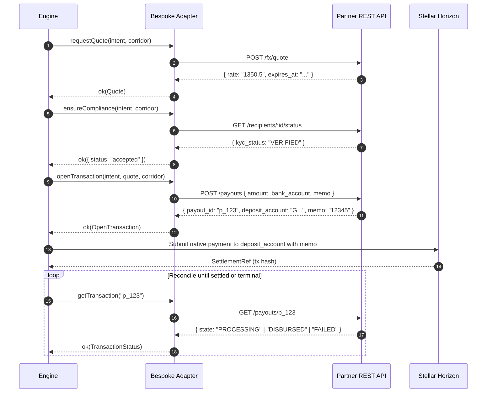

# Implementing an `AnchorAdapter` for a bespoke anchor HTTP API

The engine knows only the `AnchorAdapter` port (`@corridor/adapter-kit`). It never assumes that the counterparty on the other side of a cross-border corridor is running Stellar Anchor Platform or speaking Stellar Ecosystem Proposals (SEPs).

Standards-compliant anchors are served by one generic adapter (`@corridor/sep31`). When integrating a non-SEP partner — such as a bespoke off-ramp REST API, an OTC trading desk, or a proprietary payout provider — you implement `AnchorAdapter`.

This guide documents the engine invariants, the method-by-method contract, error handling rules, mapping typical REST APIs onto adapter verbs, and where bespoke implementations belong in the open-core architecture.

---

## Worked example

`examples/adapters/http-stub/` is a complete, runnable adapter for a bespoke
anchor, wired the way this guide describes: a fictional HTTP API served
in-process by an injected `fetchImpl`, an adapter that reports `native` quotes,
`bespoke` KYC and `stellar_payment` deposit instructions, a manifest declaring
`protocol: custom:http-stub` and `endpoints.base_url`, and a conformance run in
the test suite. Run it with:

```sh
pnpm example:stub
```

Everything in that example is fictional — `anchor.example`, invented routes, a
made-up payout asset — so it can be read, copied and run without touching a
real anchor or a real network. `tests/http-stub-adapter.test.ts` fails if a
URL in the example points anywhere but a reserved example domain.

---

## The `AnchorAdapter` contract

Every adapter implements the `AnchorAdapter` interface defined in `packages/adapter-kit/src/index.ts`:

```ts
export interface AnchorAdapter {
  readonly name: string;
  capabilities(): AdapterCapabilities;
  requestQuote(intent: PaymentIntent, corridor: Corridor): Promise<Outcome<Quote>>;
  ensureCompliance(intent: PaymentIntent, corridor: Corridor): Promise<Outcome<KycResult>>;
  openTransaction(
    intent: PaymentIntent,
    quote: Quote,
    corridor: Corridor,
  ): Promise<Outcome<OpenTransaction>>;
  getTransaction(transactionId: string): Promise<Outcome<TransactionStatus>>;
  requestRefund(
    transactionId: string,
    amount: Money,
    reason: string,
  ): Promise<Outcome<RefundRef>>;
}
```

All methods return `Promise<Outcome<T>>` (`Ok<T>` or `Err<CorridorError>`). **Methods must never throw uncaught exceptions**; failures are returned as values using `fail(code, message, opts)`.

---

### 1. `capabilities(): AdapterCapabilities`

Synchronously declares what features and protocols this adapter supports so the engine and pre-flight checks can fail early rather than discovering missing features mid-flight.

```ts
export interface AdapterCapabilities {
  readonly protocol: string;
  readonly quotes: readonly ("sep38_firm" | "sep38_indicative" | "native" | "none")[];
  readonly kyc: "sep12" | "sep6_fields" | "bespoke" | "none";
  readonly settlement: readonly string[];
  readonly refunds: "request" | "report_only" | "none";
  readonly callbacks: boolean;
}
```

- `protocol`: E.g., `"sep31"`, `"bespoke_rest"`, or `"otc_desk"`.
- `quotes`: Specify supported quote styles:
  - `"native"`: The bespoke API provides its own firm or indicative quotes.
  - `"sep38_firm"` / `"sep38_indicative"`: SEP-38 quote protocol.
  - `"none"`: The adapter provides no quotes (e.g. fixed rates or external feed).
- `kyc`:
  - `"bespoke"`: The adapter handles partner-specific customer verification.
  - `"sep12"`: Standard SEP-12 customer endpoints.
  - `"sep6_fields"`: Inline customer info fields.
  - `"none"`: No customer KYC required by the anchor.
- `settlement`: Array of supported deposit instruction identifiers, e.g. `["stellar_payment"]`.
- `refunds`:
  - `"request"`: The anchor exposes an endpoint to initiate refunds (`requestRefund`).
  - `"report_only"`: The anchor only reports refunds via transaction status updates (like SEP-31).
  - `"none"`: Refunds are not supported or reported.
- `callbacks`: `true` if the anchor supports push status callbacks/webhooks, `false` if polling only.

---

### 2. `requestQuote(intent: PaymentIntent, corridor: Corridor): Promise<Outcome<Quote>>`

Requests an exchange rate quote for `intent.sourceAmount`.

```ts
export interface Quote {
  readonly id: string;
  readonly price: string; // Dest units per 1 source unit (decimal string)
  readonly expiresAt: number; // Epoch ms after which a firm quote is void
  readonly sourceAmount: Money;
  readonly destAmount: Money;
  readonly fee?: Money;
  readonly firm: boolean; // Binds the counterparty to this rate
}
```

#### Invariants & Rules

- **Money amounts are strings, never numbers**: `Money.amount` is a string (e.g., `"100.50"`), and `price` is a decimal string. Floating-point numbers lose precision during stroop conversion and FX calculations.
- **Future expiry**: `expiresAt` must be a timestamp strictly in the future (`expiresAt > Date.now()`). The engine's pre-settle safety checks verify that the firm quote window will survive transaction building, signing, and on-chain confirmation.
- **Honor anchor sell amount**: If the counterparty deducts fees or adjusts for minimum sizes on the source side, return the counterparty's exact `sourceAmount`.
- **Quote arithmetic check**: If the counterparty returns both all-in totals and fees, ensure `sourceAmount` and `destAmount` are consistent before returning `ok(quote)`.

---

### 3. `ensureCompliance(intent: PaymentIntent, corridor: Corridor): Promise<Outcome<KycResult>>`

Verifies that the recipient (and sender, if required) is cleared to receive funds.

```ts
export interface KycResult {
  readonly status: "accepted" | "pending" | "rejected";
  readonly customerId?: string;
}
```

#### Invariants & Rules

- **Fail-closed**: Any status other than `"accepted"` halts the payment pipeline before settlement:
  - `"accepted"`: Clear to settle.
  - `"pending"`: Verification in progress (e.g. pending document review). The engine will not settle.
  - `"rejected"`: Compliance declined. The engine fails with `KYC_REJECTED`.
- **Identity pass-through**: The engine never handles customer PII directly. Customer registration (e.g., uploading identity documents or collecting national IDs) occurs out-of-band or in an upstream boundary layer. The engine passes only opaque references (such as `intent.recipient.sep12Id` or custom IDs in `intent.recipient.id`).

---

### 4. `openTransaction(intent: PaymentIntent, quote: Quote, corridor: Corridor): Promise<Outcome<OpenTransaction>>`

Instructs the counterparty to prepare a payout transaction and returns the deposit instructions (where to send the bridge asset).

```ts
export type DepositInstructions =
  | {
      readonly kind: "stellar_payment";
      readonly to: string;
      readonly memo?: string;
      readonly memoType?: "text" | "hash" | "id";
      readonly asset?: string;
    }
  | {
      readonly kind: "claimable_balance";
      readonly claimant: string;
      readonly asset?: string;
      readonly predicateSeconds?: number;
    }
  | { readonly kind: "adapter_settled"; readonly reference?: string };

export interface OpenTransaction {
  readonly transactionId: string;
  readonly instructions: DepositInstructions;
  readonly amountIn?: Money;
  /** @deprecated Read from `instructions`. Kept for one release. */
  readonly depositAddress?: string;
  /** @deprecated Read from `instructions`. Kept for one release. */
  readonly memo?: string;
  /** @deprecated Read from `instructions`. Kept for one release. */
  readonly memoType?: "text" | "hash" | "id";
}
```

#### Invariants & Rules

- **Deposit instructions**: return `instructions`, and make its `kind` one of the kinds you list in `capabilities().settlement`. For a normal on-chain payout that is `{ kind: "stellar_payment", to, memo, memoType }`, where `to` is the Stellar account the bridge asset should be paid to. The engine routes settlement on `instructions.kind`; a kind with no matching strategy fails closed with `SETTLEMENT_FAILED` before anything is submitted.
- **Legacy fields**: the flat `depositAddress`/`memo`/`memoType` are deprecated. Set them alongside `instructions` only if you must support an older engine; new adapters should set `instructions` alone (`toLegacy()` derives the flat view for callers that still need it).
- **`memoType` precision**:
  - `"text"`: Up to 28 UTF-8 bytes.
  - `"id"`: 64-bit unsigned integer string.
  - `"hash"`: 32-byte hash (frequently hex or base64 from reference platforms). Do **not** default to `"text"` if the partner issues a hash memo; treating 32-byte hashes as text fails on-chain submission because it exceeds the 28-byte text cap.
- **Payout metadata**: Pass destination fields (bank account number, sort code, CLABE, routing number) from `intent.destinationFields`.

---

### 5. `getTransaction(transactionId: string): Promise<Outcome<TransactionStatus>>`

Fetches the current status of an open payout transaction. This method is called repeatedly during the engine's `reconcile` polling phase.

```ts
export interface TransactionStatus {
  readonly status: string;
  readonly phase?: "anchor" | "external";
  readonly settled: boolean;
  readonly terminalFailure?: boolean;
  readonly awaitingInput?: boolean;
  readonly refunds?: RefundInfo;
  readonly amountIn?: Money;
  readonly depositAddress?: string;
  readonly memo?: string;
  readonly memoType?: "text" | "hash" | "id";
}
```

#### Crucial Invariants

1. **The Never-Settled-on-Unknown-Status rule**:
   An unrecognized or unmapped status string from the partner's API must **NEVER** set `settled: true`.

   ```ts
   // ALWAYS fail-open to continued polling, NEVER declare settled on unknown status:
   return {
     status: rawStatus,
     settled: false,
     terminalFailure: false,
     awaitingInput: false,
   };
   ```

   If an adapter incorrectly declared an unknown status as `settled: true`, the engine would finish the run and mark the transfer completed before money actually reached the beneficiary.

2. **`terminalFailure` semantics**:
   Set `terminalFailure: true` when the counterparty reports an unrecoverable failure (e.g. `"failed"`, `"rejected"`, `"expired"`, `"cancelled"`).
   When `terminalFailure` is set:
   - The engine immediately stops polling without waiting out the corridor's timeout.
   - It routes immediately to recovery (refund or manual hold).
   - `settled` must be `false`.

3. **`awaitingInput` semantics**:
   Set `awaitingInput: true` when the transfer is halted waiting for human or external action (e.g., the partner needs additional KYC documents or corrected bank account details).
   - Polling continues.
   - If the payment ultimately times out while `awaitingInput` is true, the engine's timeout error indicates the delay was operational (waiting on input) rather than an anchor outage.

4. **`phase` semantics**:
   - `"anchor"` (default): Internal processing within the partner's domain. Subject to standard consecutive-poll stall detection (`stallThreshold`, default 10 polls).
   - `"external"`: Handed off to a downstream clearing house or local banking rail (e.g., ACH, SEPA, SPEI, NIBSS). Uses `externalStallMs` rather than strict short-count poll stall limits.

5. **Expected transaction reflection (`amountIn`, `depositAddress`, `memo`)**:
   When the partner's status record reports back the deposit parameters it expects, populate `amountIn`, `depositAddress`, `memo`, and `memoType` on the `TransactionStatus`. The engine's pre-settle verification checks these fields against the payment intent to catch drift or tampering before on-chain funds move.

6. **Refund details (`RefundInfo`)**:
   If the anchor executes a refund, populate `refunds`:
   ```ts
   export interface RefundInfo {
     readonly amountRefunded: Money;
     readonly amountFee: Money;
     readonly payments: readonly RefundPayment[];
     readonly completeness: "full" | "partial" | "unknown";
   }
   ```
   Never return a zero-filled dummy object (`amountRefunded: "0"`) when no refund occurred — leave `refunds` `undefined`. "Refunded zero" and "no refund reported" represent different states.

---

### 6. `requestRefund(transactionId: string, amount: Money, reason: string): Promise<Outcome<RefundRef>>`

Requests that the counterparty initiate a refund for an unfulfilled payout.

```ts
export interface RefundRef {
  readonly transactionId: string;
  readonly status: "pending" | "refunded" | "rejected";
  readonly refundId?: string;
  readonly message?: string;
}
```

- If the partner's API does not support sender-initiated refund requests, return:
  ```ts
  return fail("REFUND_UNSUPPORTED", "Partner does not support API refund requests", {
    retryable: false,
  });
  ```
- If the partner accepts the request, return `status: "pending"` (if asynchronous) or `status: "refunded"` (if already credited), with an optional tracking `refundId`.

---

## Mapping a typical REST flow onto adapter verbs

Bespoke anchor APIs often follow a REST pattern:

| Partner API Endpoint / Step                    | `AnchorAdapter` Verb                     | Engine Lifecycle Phase          |
| :--------------------------------------------- | :--------------------------------------- | :------------------------------ |
| `POST /oauth/token` or API Key header          | Internal helper (e.g. `auth()`)          | Executed on demand by all verbs |
| `POST /fx/quote` or `GET /rates`               | `requestQuote`                           | `quote`                         |
| `GET /recipients/:id/kyc` or `/compliance`     | `ensureCompliance`                       | `comply`                        |
| `POST /payouts` (returns deposit instructions) | `openTransaction`                        | `open`                          |
| Stellar Horizon payment submission             | _Engine internal_ (`SettlementStrategy`) | `settle`                        |
| `GET /payouts/:id` (polling status)            | `getTransaction`                         | `reconcile`                     |
| `POST /payouts/:id/refund`                     | `requestRefund`                          | `recover`                       |

### Step-by-step lifecycle



---

## Deposit instructions kinds and settlement strategies

The engine uses pluggable `SettlementStrategy` implementations to deliver the bridge asset. `settle()` picks the first strategy whose `kind` equals `opened.instructions.kind`, and fails closed (`SETTLEMENT_FAILED`, not retryable) if none matches, so no money moves on a path nothing handles.

| `instructions.kind` | Strategy                                                              | What it does                                                                                    |
| ------------------- | --------------------------------------------------------------------- | ----------------------------------------------------------------------------------------------- |
| `stellar_payment`   | `StellarPaymentStrategy` (`@corridor/engine`, in `defaultStrategies`) | Submits a Stellar payment of `corridor.settlement.bridge_asset` to `to` with `memo`/`memoType`. |
| `claimable_balance` | `StellarClaimableBalanceStrategy` (`@corridor/stellar`)               | Creates a claimable balance for `claimant`, optionally time-limited by `predicateSeconds`.      |
| `adapter_settled`   | none built in                                                         | Settlement happens off-chain inside the adapter; register your own strategy for it.             |

Declare the kinds your adapter can issue in `capabilities().settlement`, and register a matching strategy in `EngineDeps.strategies` for any kind beyond `stellar_payment`. The engine runs `checkCompatibility()` before the first adapter call and fails the run with `CAPABILITY_MISMATCH` if a declared kind has no configured strategy.

---

## Error codes and retryable semantics

Use `fail(code, message, { retryable, cause })` from `@corridor/types`. Never throw exceptions.

Common error codes from `CorridorErrorCode`:

| Error Code           | When to use                                                    | `retryable`           |
| :------------------- | :------------------------------------------------------------- | :-------------------- |
| `ANCHOR_UNAVAILABLE` | Partner API 5xx, network timeouts, connection drops.           | `true`                |
| `ANCHOR_UNAVAILABLE` | Partner 401/403 due to expired token (refreshable).            | `true`                |
| `ANCHOR_UNAVAILABLE` | Partner 400 Bad Request due to permanent payload error.        | `false`               |
| `QUOTE_UNAVAILABLE`  | Quote server down or rate feed disconnected.                   | `true` (if transient) |
| `QUOTE_UNAVAILABLE`  | Malformed quote, expired rate, or bad arithmetic.              | `false`               |
| `KYC_REQUIRED`       | Customer not registered; requires external submission.         | `false`               |
| `KYC_REJECTED`       | Recipient explicitly rejected by compliance.                   | `false`               |
| `REFUND_UNSUPPORTED` | Partner API does not support sender-initiated refund requests. | `false`               |
| `SETTLEMENT_FAILED`  | Irrecoverable error building or dispatching settlement.        | `false`               |

**Rule**: Setting `retryable: true` informs the engine's recovery and backoff mechanisms that repeating the operation may succeed. Never mark business refusals (such as invalid destination bank details or compliance rejections) as retryable.

---

## Secrets and credentials handling

Bespoke adapters typically require credentials (API keys, client secrets, HMAC signing keys, or private keys).

Follow the principles detailed in [docs/key-management.md](./key-management.md):

1. **Never hardcode secrets in code or commit them to version control.**
2. **Inject credentials via constructor options**:
   ```ts
   export interface PartnerAdapterConfig {
     readonly baseUrl: string;
     readonly apiKey: string;
     readonly hmacSecret?: string;
   }
   ```
3. **Constant-time comparisons**: If verifying webhooks or partner HMAC signatures, use `constantTimeEqual` from `@corridor/types` rather than standard equality (`===`) to prevent timing side-channel attacks.
4. **Environment isolation**: Load credentials from secure environment variables, secret managers (AWS Secrets Manager, GCP Secret Manager, Vault), or HSM/KMS instances at runtime.

---

## Conformance testing

`@corridor/adapter-kit` ships a framework-agnostic harness. `runConformance()` returns a structured report instead of asserting, so you can use it from any test runner or a script:

```ts
import { runConformance } from "@corridor/adapter-kit";

const report = await runConformance(myBespokeAdapter, { intent, corridor });
for (const r of report.results) {
  console.log(`${r.name}: ${r.passed ? "PASS" : "FAIL"} (${r.detail})`);
}
if (!report.passed) process.exitCode = 1;
```

By default only read-only probes run. Pass `{ allowNetworkWrites: true }` as the third argument to also exercise `openTransaction()`, which checks that the returned `instructions.kind` is listed in `capabilities().settlement`. The probes cover: well-formed `capabilities()`, quote kinds matching `capabilities().quotes`, a known compliance status, `getTransaction()` on an unknown id returning a failure `Outcome` (never a throw), and no method throwing on a malformed corridor. See `packages/adapter-kit/README.md` for the vitest helper (`expectConformance`). The older `conformanceSuite()` remains as a thin wrapper.

You should extend your adapter's test suite with unit tests verifying:

- Status mapping for all partner status strings (including unknown status fallback).
- Terminal failure transitions.
- Awaiting input detection.
- Error code translation and `retryable` flags.

---

## Bespoke adapters under the open-core model

`corridor-in-a-box` operates on an open-core architecture:

1. **Open repository (`packages/*`)**:
   - Contains generic protocols (`@corridor/sep31`), the engine state machine, manifest schemas, ports, and mock implementations.
   - Any adapter that implements the open standards (SEP-10, SEP-12, SEP-31, SEP-38) lives in `packages/sep31`.

2. **Proprietary and bespoke adapters**:
   - Bespoke adapters for specific commercial partners, OTC desks, or proprietary APIs belong outside the core open repo (e.g. in private packages, internal microservices, or proprietary extensions).
   - Because `engine` depends solely on the `AnchorAdapter` interface from `@corridor/adapter-kit`, bespoke adapters plug directly into `EngineDeps.adapter` without modifying the engine codebase.
