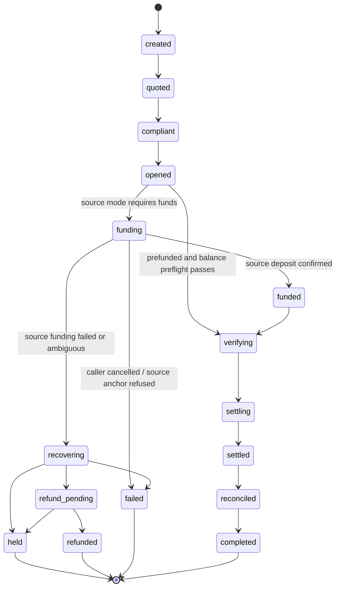

# RFC 0002: Source-side funding

- Status: proposed
- Issue: [#214](https://github.com/ezedike-evan/corridor-in-a-box/issues/214)
- Depends on: [#178](https://github.com/ezedike-evan/corridor-in-a-box/issues/178) (closed), [#182](https://github.com/ezedike-evan/corridor-in-a-box/issues/182) (closed)
- Follow-up implementation: [#216](https://github.com/ezedike-evan/corridor-in-a-box/issues/216)

## Summary

The engine currently assumes the operator's signing account already holds the
bridge asset. `settle()` submits `q.sourceAmount.amount` of
`settlement.bridge_asset` (`packages/engine/src/verbs.ts:74`) and
`examples/fund-testnet-sender.ts` funds that account by hand. The `source`
manifest block is only a name and placeholder home domain
(`corridors/ng-cowrie.corridor.yaml:19-23`), and `RouteDecision` only names the
receiving anchor (`packages/router/src/index.ts:12-17`).

This RFC adds an explicit source-funding step. The operator either:

1. **prefunds** the treasury account with the bridge asset, or
2. acquires it through a **source on-ramp** (SEP-6 deposit, a bespoke API, or a
   SEP-24 handoff) before settling to the destination anchor.

Source funding is a distinct leg with its own evidence and failure states. It is
not hidden inside the destination adapter and it is not inferred from a quote.

## Decision

### Modes

| Mode            | Meaning                                                          | Engine behaviour                                                                                                                                             |
| --------------- | ---------------------------------------------------------------- | ------------------------------------------------------------------------------------------------------------------------------------------------------------ |
| `prefunded`     | Treasury already holds the bridge asset.                         | Verify the treasury balance covers the amount plus fee/reserve, then record `funded`.                                                                        |
| `sep6_deposit`  | Source anchor issues programmatic deposit instructions.          | Start the deposit, persist the source transaction id and instructions, poll until the source anchor reports the deposit complete, then record `funded`.      |
| `bespoke`       | A configured source adapter exposes its own deposit/on-ramp API. | Delegate to the source adapter; persist its durable reference and typed result.                                                                              |
| `sep24_handoff` | A user-facing application completes a SEP-24 deposit.            | The engine never drives the interactive session. It starts only after the caller supplies proof/reference that the deposit completed, then records `funded`. |

SEP-24 is a **handoff** mode, not an unattended engine flow. This matches RFC
0001's exclusion of SEP-24 from unattended runs and
`docs/protocols/sep24.md`.

### Sequencing: open the destination first, then fund

The state machine inserts `funding` and `funded` **between `opened` and
`verifying`**:



Concretely, the run order becomes:

1. quote both legs (source and destination),
2. comply,
3. open the destination transaction (SEP-31 `POST /transactions`, etc.),
4. fund the source side,
5. re-check the two-leg quote budget immediately before settlement,
6. settle and reconcile.

Opening the destination first is deliberate. Opening a transaction moves no
money; it gives the engine the destination instructions and lets it reject an
unusable destination before taking the sender's fiat. If the source funding then
fails, the destination transaction simply expires or is abandoned and no source
money has moved. Funding first would strand value in the treasury whenever the
destination open fails.

For `prefunded`, steps 4-5 are a balance preflight and the run goes
`opened -> verifying` directly (the `funding`/`funded` states are not persisted).

### Two-leg quote

A source on-ramp adds a second rate. The effective rate is:

```text
destination_amount = source_amount * source_rate * destination_rate
```

Both legs carry their own quote id, expiry, and firmness. The engine persists
both and computes an effective `quote_expires_at = min(source_expiry,
dest_expiry)`.

`fx.quote_ttl_seconds` is a **budget**, not a guarantee. The budget must cover:

- source funding initiation and confirmation,
- destination open,
- settlement submission and a safety margin before the earliest firm expiry.

If funding outlives the earliest firm quote, the run does **not** settle. It
enters `recovering` with `QUOTE_EXPIRED`, or refreshes **both** quotes as one
unit and restarts from `quoted`. A single-leg refresh is forbidden: a fresh
source rate with a stale destination rate can change the effective price without
the receiving anchor agreeing to it.

`who_holds_risk` remains the destination-side FX risk declaration in this
increment. Source-side risk is an explicit source-mode property
(`source.funding.risk_holder`) rather than overloading the existing field.

### Treasury account model

- One Stellar treasury account (or one per bridge asset/network) holds the
  bridge asset and signs settlement payments.
- Treasury is **not** a customer deposit account. Source on-ramps deposit
  directly to the treasury address the source adapter issues.
- A preflight checks balance >= `sourceAmount + network fee + minimum reserve`
  before any settlement. Insufficient funds fails before `verifying`; it never
  produces a chain submission that could fail mid-flight.
- Treasury keys follow `docs/key-management.md`. Signing keys are never in run
  records, logs, or the manifest.
- A run stores only the treasury public address, asset, amount, and durable
  source reference.

### Source funding evidence

A run is `funded` only when there is durable evidence:

- `prefunded`: the preflight balance snapshot and transaction submission plan;
- `sep6_deposit`/`bespoke`: the source anchor's transaction id plus a terminal
  success status (never a client-supplied boolean);
- `sep24_handoff`: the external deposit reference and amount confirmed by the
  caller/integrator; the engine records it, it does not re-drive the webview.

Funding evidence is idempotent. Replaying the same source transaction id must
not create a second funding record or move value twice.

## Failure matrix

| Scenario                                                                                                                                    | Money location                        | State                          | Behaviour                                                                                                          |
| ------------------------------------------------------------------------------------------------------------------------------------------- | ------------------------------------- | ------------------------------ | ------------------------------------------------------------------------------------------------------------------ |
| Source funding fails before any deposit is accepted                                                                                         | Sender / source anchor                | `recovering` or `failed`       | No destination settlement. Abandon/expire the opened destination transaction. Do not refund because nothing moved. |
| Source deposit status is pending or ambiguous                                                                                               | Source anchor / in flight             | `funding`                      | Keep polling; never settle. After the corridor timeout, `recovering`/`held`.                                       |
| Source funding succeeds, then destination settlement fails                                                                                  | Operator treasury                     | `recovering` -> `held`         | Funds sit in treasury, not automatically refunded. Recovery/reconciliation is a separate policy decision.          |
| Source funding succeeds, destination open fails (possible when a caller forces open-after-fund, or a prefunded run reuses an existing open) | Operator treasury                     | `recovering` -> `held`         | Record the source reference and treasury balance; no automatic refund.                                             |
| Funding amount is less than quoted                                                                                                          | Partial in treasury                   | `recovering` / `held`          | Never settle the short amount. Re-quote or recover manually.                                                       |
| Funding amount is more than quoted                                                                                                          | Excess in treasury                    | `funded`                       | Settle only the quoted amount; excess stays in treasury and is reconciled separately.                              |
| Quote expires during funding                                                                                                                | Treasury unchanged or already funded  | `recovering` / `QUOTE_EXPIRED` | Do not settle. Refresh both quotes and restart, or hold for manual recovery.                                       |
| Duplicate source callback / replay                                                                                                          | Treasury unchanged after first credit | unchanged                      | Idempotency by source transaction id; ignore duplicates.                                                           |
| SEP-24 handoff never completes                                                                                                              | Sender / anchor webview               | `funding` -> `held`            | Engine has no interactive control; timeout and hold.                                                               |
| Source anchor refunds after a failed run                                                                                                    | Returned to source account            | `refunded`                     | Record the anchor refund reference; never treat it as a settlement.                                                |

## Invariants

- No state may move from `funded` back to `funding` without an explicit new
  source reference.
- `funded` -> `settling` must pass the two-leg quote budget check and the
  destination gate.
- A run that has submitted settlement never returns to `settling` (preserved
  from `packages/engine/src/state.ts`).
- Funding and settlement references are persisted before retry/resume decisions.
- Customer PII is never persisted in funding records, alerts, or logs.

## Config and manifest additions

Proposed fields (follow-up schema work):

```yaml
source:
  funding:
    mode: prefunded | sep6_deposit | bespoke | sep24_handoff
    bridge_asset: USDC
    treasury_account: G...
    risk_holder: operator | source_anchor
```

Defaults remain `prefunded` so existing corridors keep their current behaviour.
Unknown modes fail validation.

## Follow-up implementation issues

- [#216](https://github.com/ezedike-evan/corridor-in-a-box/issues/216) - engine:
  optional fund step that on-ramps via the source adapter before settle.
- Manifest/schema: add `source.funding` mode, treasury account, and two-leg quote
  fields; reject unknown modes.
- Source adapter: SEP-6 deposit adapter with durable transaction reference and
  status polling.
- Engine: add `funding`/`funded` states and the `opened -> funding -> funded ->
verifying` transitions without weakening the no-double-settle invariant.
- Quote service: compose source x destination rates, compute the effective
  expiry, and refresh both legs atomically.
- Treasury: balance preflight, asset/reserve checks, and insufficient-funds
  failure before settlement.
- Recovery: source-funded + destination-failed runbook and the `held` ownership
  policy; no automatic refund without an explicit source-anchor refund contract.
- SEP-24: handoff contract for external proof of deposit.

## Maintainer sign-off

- RFC review: pending on the pull request that introduces this document.
- Once approved, record the maintainer, date, and any accepted deviations here
  before implementation issues are opened.

## Decision record

Adopt the prefunded/on-ramp split, destination-open-first sequencing, two-leg
quote budget, treasury-account model, and the failure matrix above. Source
funding remains a separate adapter/port responsibility; the destination adapter
never gains a hidden funding responsibility.
